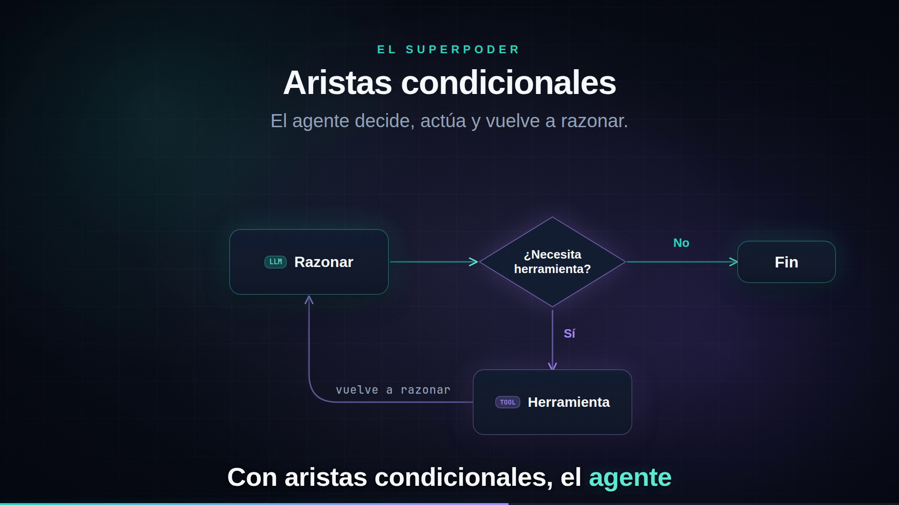

# Remotion + Kokoro + Whisper Lab

A small, reproducible Remotion project that turns a Spanish script into a fully narrated, captioned video. The example explains LangGraph in 31.9 seconds: React animations, local Kokoro text-to-speech, word-level Whisper timestamps, and optional background music.

The example is intentionally self-contained: the narration, caption JSON and final MP4 are committed so the project can be explored before downloading any model. The documentation below is in Spanish because the example narration is in Spanish.

## Demo

[](examples/langgraph.mp4)

- Video: [`examples/langgraph.mp4`](examples/langgraph.mp4)
- Duración: 31.87 s · 956 frames · 1920×1080 · 30 fps
- Códec: H.264 + AAC
- Voz: Kokoro `ef_dora` en español
- Subtítulos: Whisper.cpp `small` con timestamps por palabra

## Stack

| Pieza | Versión / uso |
| --- | --- |
| Remotion | `4.0.543`, composición `LangGraphExplainer` |
| React | `19.3.1` |
| TypeScript | `5.9.3` |
| Kokoro | `0.9.4`, voz `ef_dora`, salida 24 kHz mono |
| Whisper.cpp | `1.5.5`, modelo `small`, idioma `es` |
| Subtítulos | `@remotion/captions` + `createTikTokStyleCaptions` |
| Audio | FFmpeg `loudnorm`, −16 LUFS / −1.5 dBTP |

## Requisitos

Probado en Ubuntu 24.04.5 LTS con Node `v26.13.1`, npm `11.20.0`, Python `3.12.3` y FFmpeg `6.1.1`.

- Node.js `^20.19`, `^22.13` o `>=24`.
- Python 3.10–3.12 con `venv`.
- FFmpeg, `build-essential`, CMake y `espeak-ng`.
- Librerías de Chrome Headless Shell en Linux. En Ubuntu 24.04 incluyen `libasound2t64`, `libatk1.0-0t64`, `libcups2t64` y `libatk-bridge2.0-0t64`.
- Conexión a Internet la primera vez: Kokoro, el modelo de Whisper y Chrome Headless Shell se descargan automáticamente.
- Varios GB libres: PyTorch y el entorno de Whisper ocupan espacio, aunque no se versionan.

En macOS, instala las herramientas del sistema con Homebrew:

```bash
brew install ffmpeg cmake espeak-ng
```

## Instalación

```bash
git clone git@github.com:SimplyVisio/remotion-kokoro-lab.git
cd remotion-kokoro-lab
bash scripts/setup.sh
```

`setup.sh` muestra los paquetes de sistema que va a instalar y pide confirmación antes de usar `sudo`. Después crea `.venv-tts`, instala las dependencias de Python y npm, y descarga Chrome Headless Shell con `npx remotion browser ensure`.

Si no tienes nvm, el script se detiene y muestra los comandos oficiales para instalarlo:

```bash
curl -o- https://raw.githubusercontent.com/nvm-sh/nvm/v0.40.3/install.sh | bash
export NVM_DIR="$HOME/.nvm"
. "$NVM_DIR/nvm.sh"
nvm install --lts
```

Instalación manual equivalente:

```bash
npm ci
python3 -m venv .venv-tts
. .venv-tts/bin/activate
python -m pip install --upgrade pip wheel
python -m pip install -r requirements.txt
npx remotion browser ensure
```

## Uso

```bash
npm run dev    # Remotion Studio en http://localhost:3000
npm run lint   # ESLint + TypeScript
npm run build  # bundle de Remotion
npm run render # out/langgraph.mp4
```

Para volver a generar la narración y los subtítulos:

```bash
npm run build:audio
```

La primera ejecución tarda varios minutos porque descarga los modelos. Las siguientes son mucho más rápidas, aunque Whisper sigue transcribiendo en CPU.

## Pipeline de audio y subtítulos

`npm run build:audio` ejecuta dos pasos:

1. **Kokoro** (`scripts/tts.py`) lee `scripts/guion.txt`, sintetiza cada sección y escribe:
   - `public/narracion.wav`: voz normalizada a −16 LUFS, 24 kHz mono.
   - `src/narration-timing.json`: inicio y fin de cada escena en milisegundos.
2. **Whisper.cpp** (`scripts/transcribe.mjs`) convierte la narración a 16 kHz, transcribe en español con timestamps por palabra y escribe:
   - `public/captions.json`: palabras alineadas con el guion, listas para `@remotion/captions`.

El guion usa una sección por escena, separadas por una línea en blanco:

```text
Primera escena.

Segunda escena.

Tercera escena.
```

Mantén el número de secciones igual al número de escenas de `src/LangGraphExplainer.tsx`. Si añades o quitas escenas, actualiza también `src/timing.ts` y las claves de `SCENE_KEYS`.

Detalles que conviene no romper:

- `LEAD_IN_MS`, `GAP_MS` y `TAIL_MS` dejan espacio para los fundidos entre escenas.
- Los límites de escena se colocan en el punto medio de cada silencio.
- Whisper se ejecuta con `tokenLevelTimestamps` y `additionalArgs: ["--split-on-word"]`. La opción booleana `splitOnWord` tiene un bug en la versión usada.
- Los timestamps usan `t_dtw * 10` con un desplazamiento de −150 ms y se alinean contra el texto del guion.
- No edites a mano `src/narration-timing.json` ni `public/captions.json`: se regeneran.

### Música opcional

Si existe `public/musica.mp3`, Remotion la detecta y la mezcla al 12 % de volumen con un fade-out de 2 segundos. Si no existe, el video va solo con voz. No subas música con derechos de autor sin permiso.

## Render

```bash
npm run render
```

El resultado se escribe en `out/langgraph.mp4`. Para renderizar el ejemplo directamente en `examples/`:

```bash
npx remotion render LangGraphExplainer examples/langgraph.mp4
```

`out/` está ignorado por Git. `examples/langgraph.mp4` sí se versiona porque es la demo pública y pesa menos de 10 MB.

## Estructura

```text
.
├── examples/                  # demo renderizada y poster
├── public/
│   ├── narracion.wav          # voz generada
│   ├── captions.json          # palabras con timestamps
│   └── musica.mp3             # opcional, no incluida
├── scripts/
│   ├── guion.txt              # guion, una sección por escena
│   ├── tts.py                 # Kokoro + timing de escenas
│   ├── transcribe.mjs         # Whisper + alineación con el guion
│   └── setup.sh               # instalación reproducible
├── src/
│   ├── components/            # piezas reutilizables y subtítulos
│   ├── scenes/                # seis escenas del ejemplo
│   ├── LangGraphExplainer.tsx # composición principal
│   ├── Root.tsx               # registro y calculateMetadata
│   ├── timing.ts              # reparto de frames por escena
│   ├── narration-timing.json  # generado por tts.py
│   └── theme.ts               # colores, tipografía y medidas
├── .agents/skills/            # skills de Remotion para agentes
├── .claude/skills             # enlace a .agents/skills
├── AGENTS.md                  # reglas para agentes
├── CLAUDE.md                  # entrada de Claude Code
└── skills-lock.json           # skills instaladas
```

## Trabajar con agentes

El repositorio incluye un subconjunto de las skills oficiales de Remotion: `remotion-best-practices`, `remotion-create`, `remotion-markup`, `remotion-studio`, `remotion-render`, `remotion-captions`, `remotion-interactivity`, `remotion-multimedia`, `remotion-docs`, `remotion-license` y `remotion-upgrade`. Se excluyeron `remotion-maps` y `remotion-saas` porque este proyecto no las usa.

Para reinstalar el subconjunto:

```bash
npx skills add remotion-dev/skills \
  --skill remotion-best-practices remotion-create remotion-markup remotion-studio \
  remotion-render remotion-captions remotion-interactivity remotion-multimedia \
  remotion-docs remotion-license remotion-upgrade
```

- **opencode**: lee `AGENTS.md` y descubre las skills en `.agents/skills/`. Pide la skill por nombre cuando la necesites.
- **Claude Code**: `CLAUDE.md` importa `AGENTS.md` con `@AGENTS.md`; las skills están en `.claude/skills/`, un enlace a `.agents/skills/`. Se invocan como `/remotion-best-practices`, `/remotion-render`, etc.
- **Antigravity**: lee `AGENTS.md` y descubre `.agents/skills/`. Usa `/skills` para listarlas o recargarlas.

Si actualizas las skills con `npx skills update`, revisa que no reaparezcan `remotion-maps` ni `remotion-saas`.

## Licencias

- **Remotion**: gratis para individuos y empresas de hasta tres personas; otros casos necesitan licencia. Consulta <https://www.remotion.dev/license> y <https://www.remotion.dev/docs/license/faq>.
- **Kokoro**: Apache 2.0.
- **Whisper / whisper.cpp**: MIT.
- **Código de este repositorio**: `UNLICENSED`. Es un ejemplo público; añade una licencia explícita si vas a reutilizarlo.
- **Música**: no se incluye ninguna pista. Usa audio propio o con licencia compatible.

## Problemas comunes

**`Package 'libasound2' has no installation candidate` en Ubuntu 24.04**

Los paquetes cambiaron a nombres `t64`. `scripts/setup.sh` ya usa `libasound2t64`, `libatk1.0-0t64`, `libcups2t64` y `libatk-bridge2.0-0t64`.

**Remotion falla al arrancar Chrome o falta `libnspr4.so`**

Instala las dependencias de Linux y vuelve a preparar el navegador:

```bash
npx remotion browser ensure
```

La lista oficial está en <https://www.remotion.dev/docs/miscellaneous/linux-dependencies>.

**pip intenta descargar CUDA sin tener GPU**

`requirements.txt` usa el índice CPU de PyTorch. Si el entorno se creó con otra configuración, bórralo y repite la instalación:

```bash
rm -rf .venv-tts
bash scripts/setup.sh
```

**Python 3.13 no funciona**

Kokoro y las dependencias actuales están probadas con Python 3.10–3.12. Instala 3.12 y crea el entorno con `PYTHON_BIN=python3.12 bash scripts/setup.sh`.

**opencode desaparece después de instalar nvm**

nvm cambia el `PATH` y el binario puede quedar asociado a otro Node. Abre una shell nueva o carga nvm y reinstala opencode con el Node activo:

```bash
export NVM_DIR="$HOME/.nvm"
. "$NVM_DIR/nvm.sh"
```

**Whisper devuelve timestamps raros o palabras partidas**

Mantén `additionalArgs: ["--split-on-word"]` en `scripts/transcribe.mjs`. No cambies a `splitOnWord: true` con Whisper.cpp 1.5.5.

**Aparece un 404 de `musica.mp3` durante el render**

Es esperado si no añadiste música. `src/Root.tsx` comprueba si el archivo existe y continúa sin él.

**La primera narración tarda mucho**

Kokoro descarga su modelo, Whisper descarga el modelo `small` (unos 466 MB) y la transcripción corre en CPU. Es normal la primera vez.
